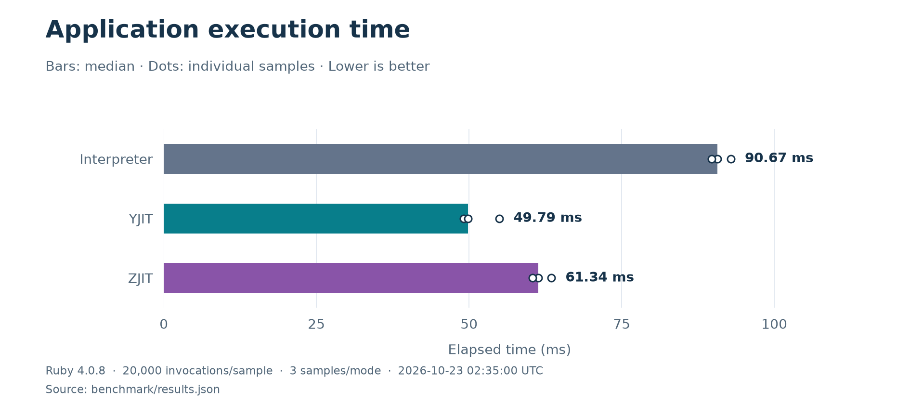
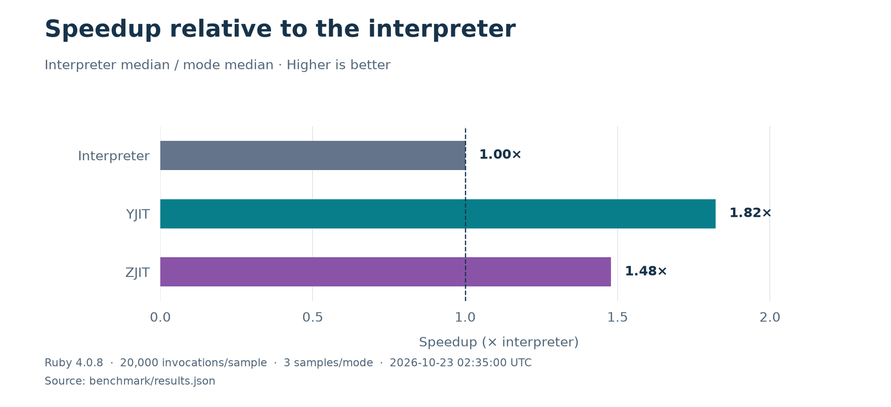

# Runtime comparison

## Results

The checked-in [raw measurements](results.json) compare the interpreter, YJIT,
and ZJIT on Ruby 4.0.8, measured on October 23, 2026. Each mode has three
samples of 20,000 application invocations after 2,000 warmup calls per process.





Speedup divides the interpreter's median elapsed time by each mode's median.
The dots in the execution-time chart show the observed samples, not confidence
intervals.

These are measurements of one small framework workload on the development
machine. They do not predict network, storage, warmup, memory, or production
application performance. Run the comparison on representative workloads before
choosing a deployment mode.

## Reproduce the measurements

Build Ruby 4.0.8 with YJIT and ZJIT available, then run:

```sh
ruby benchmark/compare.rb 20000 3 > benchmark/results.json
```

Each mode runs in a separate process. Each sample first performs 2,000 warmup
calls, then measures 20,000 application invocations. The operation constructs
scoped collaborators, calculates an integer result, and materializes an
independent value. The script verifies that the requested JIT is actually
enabled and that all processes produce the same checksum. Output includes raw
samples, elapsed time, allocations, Ruby build, and measurement date.

## Regenerate the charts

The embedded PNG charts and their SVG versions are generated from
`benchmark/results.json` using Python and Matplotlib. From the repository root,
install the optional plotting dependency and generate them:

```sh
python3 -m venv .venv
.venv/bin/python -m pip install -r benchmark/requirements.txt
.venv/bin/python benchmark/charts.py
```

After a new measurement run, regenerate the charts and update the measurement
date, sample counts, and image descriptions above to match the new results.
